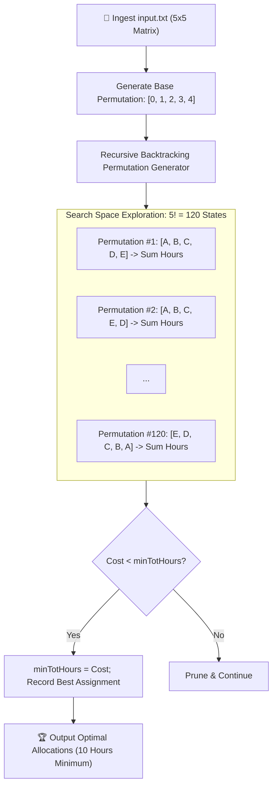

# ⚙️ Job-Man Allocation Problem — Combinatorial Optimization & Brute-Force Search

[](https://www.oracle.com/java/)
[]()
[-critical?style=for-the-badge)]()
[]()
[](LICENSE)

> **Job-Man Allocation Problem** is an algorithmic Java optimization program that solves the classical **$N \times N$ Linear Assignment Problem** using an exhaustive **Brute-Force Permutation Algorithm**. Given a cost matrix representing processing hours required for workers to complete distinct tasks, the system exhaustively evaluates all $5! = 120$ possible bipartite matches to find the global minimum processing time.

---

## 📌 Problem Formulation & Operations Research Context

In manufacturing, facility scheduling, and workforce management, assigning $N$ personnel to $N$ specialized jobs with variable proficiencies is a fundamental optimization challenge. 

### Mathematical Formulation:
Minimize total system processing time:
$$\min Z = \sum_{i=1}^{n} \sum_{j=1}^{n} C_{ij} \cdot X_{ij}$$

Subject to:
$$\sum_{j=1}^{n} X_{ij} = 1 \quad \forall i \in \{1, \dots, n\} \quad \text{(Each worker is assigned exactly one job)}$$
$$\sum_{i=1}^{n} X_{ij} = 1 \quad \forall j \in \{1, \dots, n\} \quad \text{(Each job is assigned to exactly one worker)}$$
$$X_{ij} \in \{0, 1\}$$

Where $C_{ij}$ represents the hours worker $i$ takes to finish job $j$.

---

## 📊 Processing Time Cost Matrix ($5 \times 5$)

Given the empirical time log loaded from [`input.txt`](input.txt):

| Worker | Job A | Job B | Job C | Job D | Job E |
|---|:---:|:---:|:---:|:---:|:---:|
| **Man 1** | **1** | 3 | 2 | 3 | 6 |
| **Man 2** | 2 | 4 | 3 | **1** | 5 |
| **Man 3** | 5 | 6 | **3** | 4 | 6 |
| **Man 4** | 3 | **1** | 4 | 2 | 2 |
| **Man 5** | 1 | 5 | 6 | 5 | **4** |

---

## 🧮 Algorithmic Complexity Analysis



* **Brute-Force Complexity:** $\mathcal{O}(n! \cdot n)$. For $n = 5$, the search space is $5! = 120$ permutations, executed instantaneously ($< 50 \text{ ms}$).
* **Scalability Note:** While brute force guarantees the **absolute global optimum** for small $n$, factorial growth makes it intractable for $n \ge 15$, demonstrating why polynomial algorithms (such as the Hungarian Algorithm $\mathcal{O}(n^3)$) are required for massive scale.

---

## 🏆 Optimal Global Solutions Found

The program evaluates every permutation and detects dual optimal configurations yielding the **minimum possible time of 10 Hours**:

### Optimal Configuration #1 (Total: 10 Hours)
| Assigned Worker | Optimal Job | Duration |
|---|:---:|:---:|
| **Man 1** | **Job A** | 1 Hour |
| **Man 2** | **Job D** | 1 Hour |
| **Man 3** | **Job C** | 3 Hours |
| **Man 4** | **Job B** | 1 Hour |
| **Man 5** | **Job E** | 4 Hours |
| **GRAND TOTAL** | — | **10 Hours** |

### Optimal Configuration #2 (Alternative: 10 Hours)
* **Man 1** $\to$ Job B (3h)
* **Man 2** $\to$ Job D (1h)
* **Man 3** $\to$ Job C (3h)
* **Man 4** $\to$ Job E (2h)
* **Man 5** $\to$ Job A (1h)
* **Total Time:** **10 Hours**

---

## 📂 Project Directory Structure

```text
Job_Man_Allocation_Brute_Force/
├── JobAss.java      # Java optimization driver & permutation generator
├── input.txt        # 5x5 cost matrix dataset
├── README.md        # Comprehensive operations research report & complexity analysis
└── .gitignore       # Excludes compiled bytecode (.class)
```

---

## 🛠️ Compilation & Execution Guide

### 1. Prerequisites
* **Java Development Kit (JDK):** Version 11 or newer (`javac -version`).

### 2. Clone the Repository
```bash
git clone https://github.com/akhmal02/Job_Man_Allocation_Brute_Force.git
cd Job_Man_Allocation_Brute_Force
```

### 3. Compile the Java Source Code
```bash
javac JobAss.java
```

### 4. Run the Optimization Program
```bash
java JobAss
```

---

## 👨‍💻 Authors & Academic Attribution
* **Development Team:**
  * **Muhammad Akhmal bin Mohamad Hussin** (2025124819) — [@akhmal02](https://github.com/akhmal02)
  * Imran Aufa (2025160393)
  * Danish Hazim (2025165825)
  * Aiman Fuzi (2025118501)
* **Group:** A4CDCS230 5B
* **Advisor / Lecturer:** Dr. Nursyahidah binti Alias
* **Institution:** Universiti Teknologi MARA (UiTM)
* **Faculty:** College of Computing, Informatics and Mathematics
* **Course:** Algorithm Analysis & Design (CSC645)
